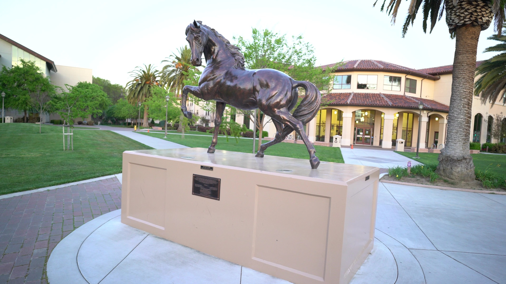
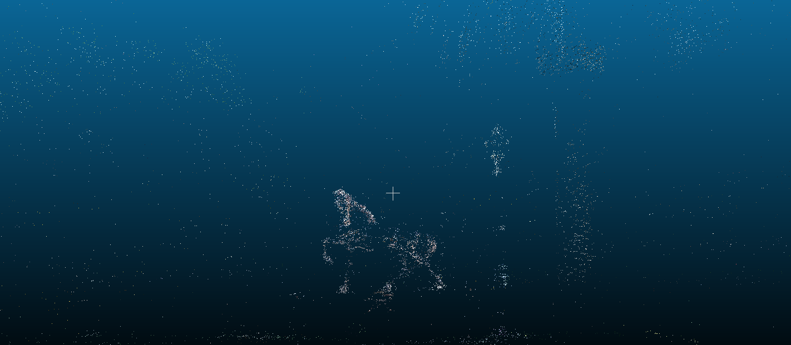

# Mini-COLMAP

> **Note:** The pipeline, options and commands described below are implemented on the
> [`feature/diagnostics-calibration-init`](https://github.com/ahmedKhaled365/Mini-COLMAP/tree/feature/diagnostics-calibration-init)
> branch. `main` still contains the earlier version of the code until that branch is merged.

A small incremental Structure-from-Motion pipeline in C++20, inspired by COLMAP.
It reconstructs a sparse 3D point cloud and camera poses from an image sequence,
and is developed on a 151-image sequence of a horse statue.

## Visual Results

<table>
  <tr>
    <td align="center"><b>Input image</b></td>
    <td align="center"><b>Reconstruction</b></td>
  </tr>
  <tr>
    <td></td>
    <td></td>
  </tr>
</table>

## Pipeline

1. **Features** – SIFT keypoints and descriptors.
2. **Matching** – FLANN with ratio test and mutual check, verified with a RANSAC fundamental matrix.
   Sequential pairs (window of 8 frames) plus loop-closure pairs from bag-of-visual-words retrieval.
3. **Initialization** – Essential matrix and pose recovery; the initial pair is chosen by parallax
   and an essential-vs-homography check.
4. **Registration** – new cameras are added with PnP RANSAC.
5. **Triangulation** – two-view triangulation with depth, reprojection and angle checks; tracks are
   extended through the match graph.
6. **Bundle adjustment** – Ceres Solver, local and global, refining poses, points, a shared focal
   length and radial distortion (k1).
7. **Output** – colored PLY point clouds, camera poses, and diagnostic reports.

## Dependencies

- C++20 compiler (developed with GCC on MSYS2 UCRT64, Windows)
- CMake ≥ 3.20 and Ninja
- OpenCV 5
- Ceres Solver (with SuiteSparse and Eigen)

`CMakeLists.txt` points to `C:/msys64/ucrt64`; adjust these paths for other setups.

## Build and Run

```bash
cmake -S . -B cmake-build-release -G Ninja -DCMAKE_BUILD_TYPE=Release
cmake --build cmake-build-release
```

The images are in `data/horse/` (`00001.jpg` … `00151.jpg`). Run from the build folder:

```bash
cd cmake-build-release
./Mini-COLMAP --images 151 --out ../results/run151
```

Useful options (`--help` lists all):

| Option | Meaning |
|---|---|
| `--images N` | number of images to use (default 20) |
| `--focal F` | initial focal length in pixels (default 1200) |
| `--ba MODE` | bundle adjustment: `none`, `final` or `incremental` (default) |
| `--loop-candidates K` | loop-closure pairs per image, `0` disables (default 5) |
| `--output LEVEL` | `minimal`, `standard` or `full` output files |

Each run writes `report.txt`, CSV logs, `points_all.ply`, `points_reliable.ply`,
`cameras.ply` and `preview.png` to the output folder. The PLY files open in MeshLab.
